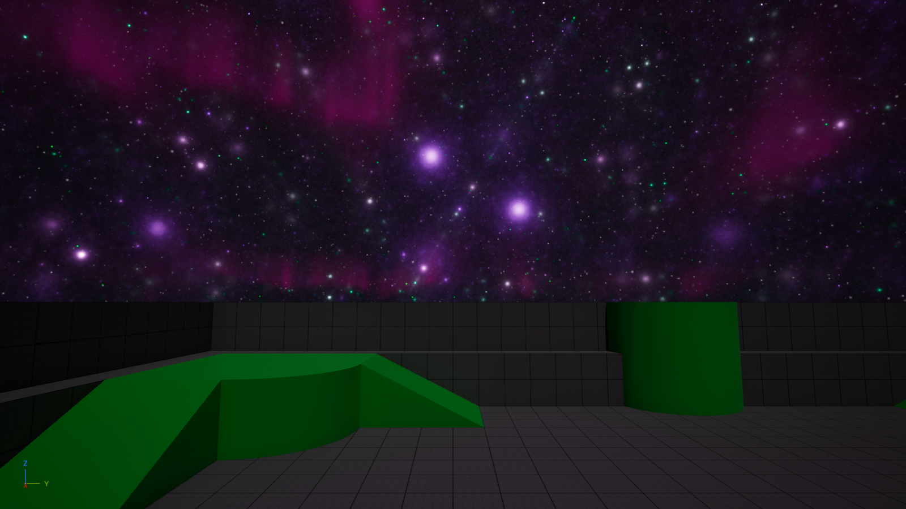
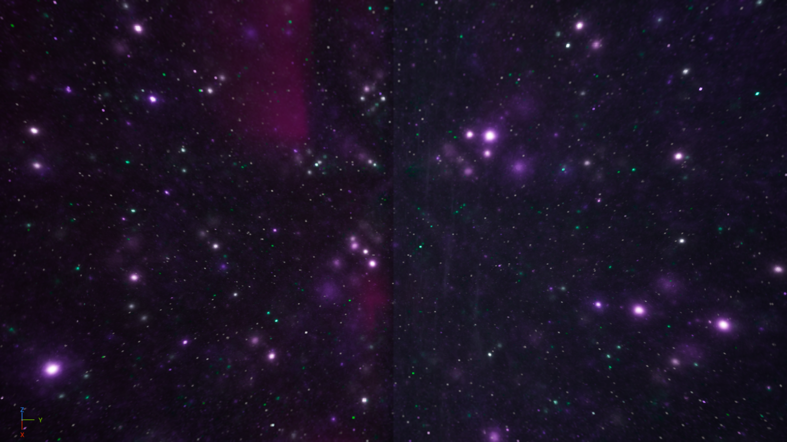
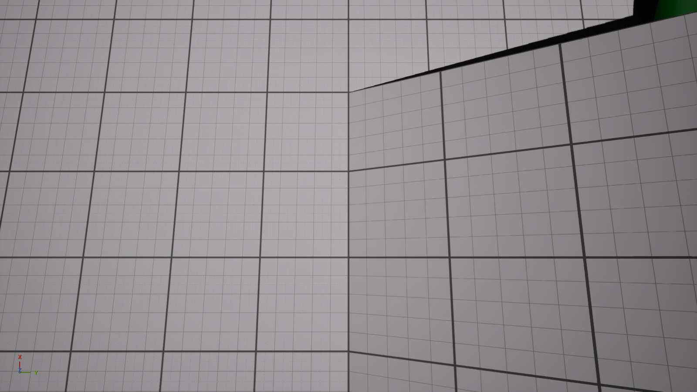

# 动态星空 / 星云 / 极光天空 —— 实现说明

> 对应方案文档：`UE复刻_动态星空极光天空盒_方案.md` **v2 修订版**
> 目标：把 `Lvl_ThirdPerson` 关卡的天空替换为动态星空
> 引擎：Unreal Engine 5.8（`D:\ue\UE_5.8`）　平台：Win64 / D3D12 / SM6

---

## 1. 结果

`Lvl_ThirdPerson` 的天空是 **紫粉系 StarNest 星云 + 点状恒星 + 紫粉极光帘**，在编辑器视口里
即可看到演化（不打 PIE 也在跑）：

- 整体是**深紫夜空**（92% 变暗生效），不是发白的霓虹紫
- 星云是品红/紫的纤维结构，高光处点缀青白
- 极光是紫粉→暗紫红渐变，只在地平线以上、向上渐隐
- 星星稀疏点状、冷暖随机、亮度是默认的两倍
- 整体**不自转**（`AutoRotate = 0`），只有星云内部按 `Speed = −0.05` 缓慢演化

画质 / 性能现状（见 §8）：

- **cube 烘焙 1024² × 6**（48 MB 显存），星星是锐利圆点而非糊点
- **15 Hz**，每次烘焙用一次 dispatch 算完全部 6 个面
- 极光 32 层（原 50）、Volsteps 20（原 28），每层常量改为查表 —— 每 texel 便宜约 42%

天空同时被 `SkyLight` 的 Real Time Capture 采样，给关卡提供环境光。

---

## 2. 架构（方案 B：计算着色器 → Cube RT → Sky 材质）

```
UAuroraSkySubsystem::Tick（按 UpdateFrequency = 15 Hz 节流）
        │  只传 3 个值：CubeSize + SkyTime（+ RWOutput）
        ▼
ENQUEUE_RENDER_COMMAND  →  StarSky_DispatchAuroraSky()
        │  SRV → UAV 屏障
        ▼
FAuroraSkyCS（全局计算着色器，8×8 线程，一次 dispatch 覆盖 6 个面）
        │  DispatchThreadID.z = face
        ▼
UTextureRenderTargetCube  1024×1024×6  PF_FloatRGBA（bSupportsUAV → TexCreate_UAV，48 MB）
        │  UAV → SRV 屏障
        ▼
M_AuroraSky（Unlit + Opaque + bIsSky）   CameraVector → TextureSampleCube × SkyIntensity → Emissive
        ▼
AAuroraSkyDome（1 km 两面向球体，走引擎 SkyPass）
        ▼
ASkyLight（Real Time Capture）
```

一次 dispatch 算完全部 6 个面；上一帧这张 cube 是被当 SRV 采样的，所以写前/写后都做了显式
`ERHIAccess::SRVMask ⇄ UAVCompute` 屏障 —— 因此**不需要双缓冲**（方案 R14 允许「RDG 依赖自动排序」这条路）。

刚创建 / 重建 RT 时会无条件立刻烘一帧（`bNeedsBake`），避免开头天空是黑的。
实测六个主轴方向各截一张图，**0% 黑像素**，6 个面都在写。

---

## 3. ★ 性能改造：天空参数全部常量化

方案 v2 把每个参数的「材质实际值」都确定了，因此这些值**运行时不需要变**，全部固化成
`AuroraSky.usf` 顶部的 `#define` / `static const`：

| 项目 | 改造前（v1 实现） | **现在** |
|---|---|---|
| 着色器 uniform 数量 | **27 个**（27 个参数走常量缓冲） | **4 个**（`CubeSize` + `CubeFaceBase` + `SkyTime` + `RWOutput`） |
| `Volsteps` / `Iterations` | uniform 循环上界 | **`#define` 20 / 16** → 上界是字面量 |
| `AuroraLayers` | uniform | **`#define` 32**（原 50） |
| 极光每层常量 | 每层现算 `pow` / `sin` / `exp2` / `Hash21` + 颜色 lerp | **4 张 `static const` 查表**（PT/OFFSET/WEIGHT/COLOR），循环里只剩求交+采样+累加 |
| 小循环 | 动态 | 内层 16 次折叠、`triNoise2d` 5 次、星星 4 次 → **`[unroll]`** |
| `AutoRotate` | uniform 1.0（每 texel 4 次 sin/cos） | **常量 0** → `a1 = 0.5`、`a2 = 0.8` 是编译期常量，**4 次 sin/cos 直接折成立即数** |
| 全部颜色 / 系数 | uniform 向量 | `static const` → 折成立即数 |
| `TimeScale` | uniform × 25 | 常量 → `t * 18.375`（一次乘法） |
| 调试分支 | uniform `DebugMode`（每个 texel 5~6 次比较） | `#define NTA_DEBUG_MODE 0`，`#if` 编译期裁剪 |
| 地面雾 | 地平线下加一层噪声蓝灰 | `#define NTA_GROUND_FOG 0` 编译期裁掉（见 §4.5） |

**每层常量查表的收益**：极光 32 层里，每层的 `pow(i,1.4)`、`sin(i*0.05)`、`exp2(-i*0.065-2.5)`、
`Hash21(i,2i)` 和一次三通道颜色 lerp **只依赖层号、与像素无关**，原实现每个 texel 都重算一遍。
表由脚本按同一公式生成，数值与逐层现算一致（float32 精度内），每 texel 省下约 **200 次超越函数**。

净效果：常量缓冲读取、循环边界比较、AutoRotate 的三角函数、极光每层常量全部消失；
大循环用 `[loop]` 阻止过度展开，小循环 `[unroll]` 展开。要改观感就改 `.usf` 顶部那几个常量，
**只需重编着色器、不用重编 C++**。

代价：`FAuroraSkySettings` 里不再有 20 多个可调参数（那些参数已经不影响结果了，留着是死代码）。
Details 面板保留的都是运行时真正需要的：材质、Cube 分辨率、更新频率、SkyIntensity、时间倍率/偏移。

---

## 4. 「天空只有半边」—— 诊断与修复

这是本轮最重要的修复。症状：水平视角看时，**地平线以下整片是均匀蓝灰色**，不是天空。

### 4.1 定位过程

1. **六方向球面巡览**（`Scripts/aurora_survey.py`）→ 6 个面 0% 黑像素，排除「某些 cube 面没写」。
2. **细粒度行剖面** → 亮度在屏幕**正中央（y=300，即 rd.y = 0）发生硬阶跃**：42 → 107，之后几乎恒定。
3. **A/B/C 三张对照**（`Scripts/aurora_probe_lower.py`，同机位）：

| 截图 | 上半屏 | 下半屏 |
|---|---|---|
| A 基线 | (34,18,39) 星空 | **(76,92,126) 蓝灰** |
| B `fog_density = 0` | (27,18,36) 星空 | **(35,18,40) 星空** ✅ |
| C 无雾 + 隐藏穹顶 | (0,0,0) | (0,0,0) |

→ **是 ExponentialHeightFog。**

### 4.2 根因

UE 5.8 的 `UMaterial::bIsSky` 属性注释写得很清楚：

> When IsSky is true, these meshes will not receive any contribution from the aerial perspective.
> **Height and Volumetric fog effects will still be applied.**

也就是说 `bIsSky` 只跳过 aerial perspective，**高度雾照旧作用在天空穹顶上**。而穹顶在 1 km 处：

- 向上看：光线朝上，`FogHeightFalloff = 0.2` 让密度指数衰减 → 几乎无雾
- 向下看：光线朝下，密度指数增长 → 光深饱和 → 整个下半球被雾涂成雾的颜色

所以出现了**地平线处一刀切的硬阶跃**，看起来就像「天空只渲染了一半」。

> 另外模板里 `FogInscatteringLuminance` 是**纯黑**（靠天空大气提供颜色）；大气删掉后先是地平线被涂成
> **纯黑带**（上一轮遇到并已修），改成夜蓝后变成**蓝灰带**（本轮遇到）。两种都是同一个根因的不同表现。

### 4.3 修复

`Scripts/aurora_setup.py` 的 `setup_height_fog()`：**`fog_density = 0`**，同时保留夜蓝
`FogInscatteringLuminance`（以后想加一点点雾也不会是黑的）。

**对关卡几乎没有影响**：密度 0.0005 时在 100 m 尺度上光深只有 0.05，本来就看不见；
真正被它影响的只有 1 km 外的穹顶。想恢复大气感，请用一个 `StartDistance > 1500 m` 的雾，
或者干脆在 `M_AuroraSky` 里补地平线渐变（方案 P3 的建议）。

---

### 4.4 另一条「竖向接缝」的真因：Y-up / Z-up 坐标错位

除了那条雾造成的**水平**分界，还曾有一条**竖直**硬边，出现在画面正中（x=799/1600），
并在所有截图里稳定复现。它一度被误判为 cube 面接缝，实际是两个更基础的问题。

#### 排除项（用数据排除，别猜）

| 怀疑对象 | 如何排除 |
|---|---|
| cube 面映射写错 | 写了纯数学自检：1536 个 texel 中，**内部 0 个**落错面、**边界 0 个**落错面；24 条共享边全部配上几何正确的邻边，唯一偏差是 0.0598 ≈ 半个 texel（正常的 texel 中心内缩） |
| cube 面边界过滤 | 该相机下 cube 面分界投影到 **x≈100 和 x≈1498**（90° 水平 FOV），而那条线在 **x=799**，位置根本不符 |
| 穹顶球体的 UV 缝 | UV 球体是**水密**的；更关键的是材质**不读网格 UV**（`CameraVector → TextureCube`），几何只负责包住方向，所以 UV 缝不可能产生任何可见线条 |
| 边界 texel 内缩 | 试过「边界 texel 吸附」，实测暗线深度 −9.11 → −8.25，**毫无变化**，说明假设错了 |

#### 真正的根因

原始 Unity shader（StarNest + 极光）是 **Y-up**：`rd.y` 代表高度，所有地平线逻辑都基于它：

```hlsl
if (rd.y > 0) { ...极光正常混合... } else { ...下半球镜像 + 地面雾... }
col *= clamp(rd.y * 15 + 0.4, 0, 1);   // 极光只在地平线以上
```

而 UE 世界是 **X 前 / Y 右 / Z 上**。此前把 UE 的世界方向**原样**喂进这套 Y-up 数学，
于是 `rd.y` 实际是「世界 Y 轴（水平方向）」，那句 `if (rd.y > 0)` 切开的不是地平线，
而是**穿过 Y 轴的一个竖直平面** —— 天空里多出一堵墙。

**为什么正好投影在画面正中**：相机 `yaw = 0` 时右向量恰好是 +Y，所以 `Y = 0` 这个大圆
在画面上精确投影成正中那条竖线。我此前所有截图都是 `yaw = 0`，所以它每次都在。

**铁证**：之前那张「仅极光」调试图（`DebugMode = 3`）中，左半青绿、**右半纯黑**。
那个分支是 `rd.y > 0 ? aur : float3(0,0,0)`；纯黑像素明明位于天空高处，`rd.y` 却是负的 ——
直接证明 `rd.y` 不是高度轴。

#### 修法（两处，缺一不可）

**① 取反：材质的 `CameraVector` 是朝内的**

引擎 `MaterialTemplate.ush` 里写得很明确：

```hlsl
Parameters.CameraVector = -WorldRayDirection();
```

也就是 `CameraVector` 是「**像素 → 相机**」（朝内），而我们拿它在 cube 上采样。于是
「屏幕视线方向 `d`」会去读方向 `-d` 的 texel —— 如果 texel `v` 里存的是 `SkyColor(v)`，
画面就会被**点对称翻转**（上下 + 左右同时翻）。症状就是「天空上下颠倒」。

所以 texel `v` 里必须存 `SkyColor(-v)`。

**② 轴向换算：UE 是 Z-up，这套数学是 Y-up**

```hlsl
// ① 取反：材质 CameraVector 朝内（= -WorldRayDirection），
//    拿它采样 cube 相当于读反方向，不取反天空就上下颠倒
const float3 rdView = -normalize(NTA_CubeFaceDirection(ScaledUVs, (int)id.z));
// ② (X, Y, Z)_UE -> (X, Z, -Y)：UE 的 +Z(上) 落到 shader 的 +Y(上)，
//    行列式 = +1，是纯旋转，不会镜像星云
const float3 rd = float3(rdView.x, rdView.z, -rdView.y);
```

`NTA_RAY_ORIGIN` 保持在 Y-up 空间不动（原 shader 本就是 `(0,0,-6.7)`，即 `ro.y = 0`）。

**链路自检**（纯数学，不必开编辑器）：对 9 个方向验证
「视线 d → CameraVector=-d → cube 查表 → compute 存的 rd」是否回到 `Axes(d)`，
最大误差 `1.9e-16`；同时证明：去掉那个负号时，正上方视线会读到 `rd.y = -1`（正好是上下颠倒）。

#### 效果（同机位量化）

| 指标 | 修复前 | 修复后 |
|---|---|---|
| 全图最强竖直分界位置 | **x=799（正中，−1 px）** | x=526（离中心 274 px，属正常星云结构） |
| x=799 处暗线深度（平均） | 0.92 | **0.29** |

同时**极光终于贴着真实地平线、向上渐隐**，下半球的镜像也回到天底 —— 之前整片天空
其实是绕一根水平轴铺开的，方向是错的。

> 注：只修 ②（轴向换算）而不修 ①（取反）的话，那条"墙"会消失，但整个天空仍然
> **上下颠倒** —— 这是第二轮才发现的，最终两个负号级的问题一起修掉了。

> 副作用：`SkyLight` 捕获到的天空内容变了（不再有那条发亮的"墙"），
> 关卡整体环境光会随之变化，属预期。

### 4.5 地面雾已关闭（`NTA_GROUND_FOG = 0`）

原 shader 在地平线以下除了镜像极光，还叠了一层**带噪声的蓝灰加法**（`else` 分支里最后那行
`col += lerp(...)`），作用是让下半球看起来像"地面雾"而不是星空。现在默认关闭：

```hlsl
#define NTA_GROUND_FOG 0    // 1 = 恢复原版行为
```

关掉的理由：

- 这一层要先被 **×0.7 左右的噪声 lerp** 压低、再被 **92% 变暗（×0.08）** 衰减，
  最终贡献只有约 **0.005–0.017 线性值**；
- 实测开关前后，地平线以下区域的平均色差只有 **0.04 / 255**（肉眼不可辨），
  它却会给下半球铺一层灰蓝色调，让画面"发闷"；
- 本工程里地平线以下绝大部分被关卡几何挡住，只有从高处越过关卡边缘往下看时才露出来。

关掉后地平线以下就是干净的镜像星空（星云 + 星星），与上半球的风格一致。

> 顺带确认：关卡里那盏 `ExponentialHeightFog` 的 `FogDensity` 早已是 **0**
> （见 §4.2，它才是之前"下半屏一片蓝灰"的元凶）。这里关的是**着色器内**的地面雾，
> 是两件不同的事。

---

## 5. 与方案文档的偏差

### 5.1 已按 v2 全面对齐

`Zoom 15.2`、`Iterations 16`、`Tile 0.75`、`Speed −0.05`、`Darkmatter 0.43`、
`Distfading 0.7`、`AutoRotate 0`、`AuroraExposure 1.175`、`AuroraTimeScale 0.735`、
`AuroraHeight 0.823`、`StarIntensity 2.0`、**`SkyDarken 0.92`**、
以及 §3.2 的 **Linear 列**配色（品红星云 / 粉紫极光 / 青白高光 / 深紫暗底）。

v1 实现漏掉的 **92% 变暗** 正是之前画面发白偏亮的根因，现已补上。

有意再调的两项（v2 之后为画质/性能重配，见 §8）：

| 参数 | v2 文档 | 现在 | 理由 |
|---|---|---|---|
| `Volsteps` | 28 | **20** | 星云 −29% 成本，星云层次略少 |
| `AuroraLayers` | 50 | **32** | 层间距 < 0.01，极光占六成 ALU，是最划算的一刀 |

### 5.2 必须偏离的地方（UE 5.8 破坏性变更）

| 文档写法 | 实际做法 | 原因 |
|---|---|---|
| `Domain = Sky` / `MD_Sky` | `Domain = Surface` + `ShadingModel = Unlit` + `BlendMode = Opaque` + **`bIsSky = true`** | **UE 5.8 删除了 `MD_Sky`**，`EMaterialDomain` 里已无此项；`bIsSky` 是官方替代，`FSkyPassMeshProcessor` 判定的就是 `FMaterial::IsSky()`，行为一致 |
| 全局着色器放游戏模块 | 独立模块 `StarSkyShaders`，`LoadingPhase = PostConfigInit` | 放 Default 阶段会触发 `Assertion failed: !AreShaderTypesInitialized() [Shader.cpp:315]`，编辑器直接崩 |
| Cube 256 | **1024** | 256 时每个 texel 约 6.3 px，点状恒星会糊成方块。1024 下是锐利圆点（512 已可用，1024 更干净）。显存 48 MB |
| 更新 15–20 Hz | **15 Hz** | 每次烘全部 6 个面；1024 下 15 Hz 已是不轻的配置，再高优先降分辨率 |
| `SkyIntensity` 放在 shader 里乘 | 放在**材质**里乘（`M_AuroraSky` 的 ScalarParameter） | 线性乘法，数学上等效；放材质里调参即时生效、不用重烘焙 |

### 5.3 保留的数值保护（文档未提，实测必需）

原 shader 在 `dot(p,p) → 0` 时 `p` 会爆到 inf，`a` 累积后 `a³` 溢出，而 cube RT 是 **RGBA16F**，
inf/NaN 会被写进贴图，在材质里表现为**彩色方块噪点**。三处加固：

```hlsl
p = abs(p) / max(dot(p, p), 1.0e-6f) - NTA_FORMUPARAM;   // 防除零爆炸
a = min(a, 1.0e4f);                                       // 防 a*a*a 溢出
col = clamp(col, 0.0f, 8.0f);
col = all(col == col) ? col : float3(0,0,0);              // NaN → 黑
```

极光 `rzt` 的 clamp 已恢复成文档的 **0.55**（v1 里曾为压噪点降到 0.40；v2 的 92% 变暗已经
把尖峰压到看不出来了）。

### 5.4 其它实测坑（都已处理）

- `UTextureRenderTarget::GetRenderTargetResource()` **只能在渲染线程调用**（内部 `check(IsInRenderingThread())`）。
  游戏线程要用 `GameThread_GetRenderTargetResource()`，且只能判空不能解引用 → 解引用和 dispatch 全放进 render command。
- `bSupportsUAV` 必须在 `Init()` **之前**设置（`CreateResource()` 据此把 `bCanCreateUAV` 置 1）。
- `-ExecutePythonScript` 跑完脚本会**自动 `QUIT_EDITOR`**，除非脚本里调
  `unreal.EditorPythonScripting.set_keep_python_script_alive(True)`。
- `unreal.Rotator(a, b, c)` 的参数顺序是 **(roll, pitch, yaw)**，不是 (pitch, yaw, roll)。
- `delete_all_material_expressions()` / 删除已被引用的材质资产会崩编辑器 → 脚本改成「材质存在即复用」。
- `SkyAtmosphere` / `VolumetricCloud` 是 `USceneComponent`，**没有 `SetVisibility`**，隐藏无效，只能删除。
- MID 不能作为 MID 的父级（`AAuroraSkyDome::ApplySkyMaterial()` 会先拆回父材质再重建）。

---

## 6. 新增 / 改动文件

| 文件 | 作用 |
|---|---|
| `Shaders/Private/AuroraSky.usf` | HLSL 主体，**所有天空参数都是编译期常量** |
| `Source/StarSkyShaders/StarSkyShaders.Build.cs` | 着色器模块（LoadingPhase = PostConfigInit） |
| `Source/StarSkyShaders/Public/AuroraSky/AuroraSkyShaders.h` | `FAuroraSkyCS : FGlobalShader`，`FParameters` 只有 3 个字段 |
| `Source/StarSkyShaders/Public/AuroraSky/AuroraSkyShaderDispatch.h` | 导出的 `StarSky_DispatchAuroraSky()`（跨模块不暴露 shader 类型） |
| `Source/StarSkyShaders/Private/AuroraSkyShaderDispatch.cpp` | 参数填充 + 屏障 + dispatch |
| `Source/UE_ArtEffect_StarSky/AuroraSky/AuroraSkySettings.h` | `FAuroraSkySettings`（只剩运行时必需的 7 项） |
| `Source/UE_ArtEffect_StarSky/AuroraSky/AuroraSkySubsystem.h/.cpp` | 世界子系统：RT 管理 / 节流 / MID 绑定 |
| `Source/UE_ArtEffect_StarSky/AuroraSky/AuroraSkyDome.h/.cpp` | `AAuroraSkyDome`：承载 MID + 跟随相机 |
| `Scripts/aurora_setup.py` | 一键落地：建材质、改关卡、放穹顶、截图 |
| `Scripts/aurora_verify.py` | 纯验证：干净加载、三个角度截图，不改任何东西 |
| `Scripts/aurora_survey.py` | 六方向球面巡览（诊断「半边」用） |
| `Scripts/aurora_probe_lower.py` | 雾的 A/B/C 对照（诊断「半边」用） |

引擎侧改动仅两处：
- `UE_ArtEffect_StarSky.uproject` — 新增 `StarSkyShaders` 模块（PostConfigInit）
- `UE_ArtEffect_StarSky.Build.cs` — 依赖 `RenderCore` / `RHI` / `StarSkyShaders`

---

## 7. 怎么用

### 打开即见

直接打开 `Lvl_ThirdPerson`，编辑器视口里就有动态星空（`IsTickableInEditor()` 返回 true）。

### 改观感

改 `Shaders/Private/AuroraSky.usf` 顶部的常量（和方案 §3.1 / §3.2 一一对应），重启编辑器即可。
诊断分通道：把 `#define NTA_DEBUG_MODE` 改成
`1` 仅星云 / `2` 仅星星 / `3` 仅极光 / `4` 亮度灰度 / `5` 仅地平线下雾。

### 运行时可调项（`AAuroraSkyDome` 的 Details 面板）

| 项 | 说明 |
|---|---|
| `CubeResolution` | **1024（默认，48 MB）** / 512（成本 ÷4，星星略钝）/ 256（÷16，糊成方块） |
| `UpdateFrequency` | **15 Hz**（每次烘全部 6 个面） |
| `SkyIntensity` | 最终亮度倍率，用来和自己的曝光对齐 |
| `SkyTimeScale` / `SkyTimeOffset` | 演化速度倍率（0 = 暂停）/ 对齐 Unity 某一帧 |
| `DomeRadiusMeters` / `bFollowCamera` | 穹顶半径 / 是否跟随相机 |

### 重新落地 / 只验证

```powershell
# 编辑器必须关闭
D:\ue\UE_5.8\Engine\Build\BatchFiles\Build.bat UE_ArtEffect_StarSkyEditor Win64 Development `
  -Project="E:\UE_ArtEffect_StarSky\UE_ArtEffect_StarSky.uproject"

# 落地（幂等：材质/穹顶已存在就复用）
D:\ue\UE_5.8\Engine\Binaries\Win64\UnrealEditor.exe `
  "E:\UE_ArtEffect_StarSky\UE_ArtEffect_StarSky.uproject" `
  -ExecutePythonScript="E:\UE_ArtEffect_StarSky\Scripts\aurora_setup.py"

# 只验证（不改任何东西）
D:\ue\UE_5.8\Engine\Binaries\Win64\UnrealEditor.exe `
  "E:\UE_ArtEffect_StarSky\UE_ArtEffect_StarSky.uproject" `
  -ExecutePythonScript="E:\UE_ArtEffect_StarSky\Scripts\aurora_verify.py"
```

---

## 8. 性能

### 8.1 当前配置（1024 / 15 Hz / 每次整烘 6 面）

| 项 | 数值 |
|---|---|
| cube 分辨率 | **1024² × 6**（PF_FloatRGBA，**48 MB** 显存） |
| 每次烘焙 | **6 个面一次 dispatch** = 629 万 texel |
| 烘焙频率 | **15 Hz**（每 66.7 ms 一次） |
| 单帧峰值 | **629 万 texel**（原 512/6 面是 157 万 → 4 倍） |
| 稳态吞吐 | 15 × 629 万 ≈ **94 M texel/s**（原 18.9 M） |
| 每 texel 迭代 | 20×16 = 320 次折叠（原 448）+ **32 层**极光（原 50） |
| 每 texel 超越函数 | 约 **550**（原约 750）—— 每层 4 个 `pow/sin/exp2/hash` 改为常量查表 |
| 折算等效成本 | × 0.65（每 texel 更便宜）→ **约原来总开销的 5 倍** |

**取舍说明**：这一版是**用开销换画质** ——
① 角分辨率 ×4（星星从糊点变成锐利圆点）、
② 频率 12 → 15 Hz（极光流动更顺）、
③ 每 texel 便宜约 42%（层数、Volsteps、常量查表）。
代价是总 GPU 工作量约为原来的 5 倍、单帧峰值 4 倍。

> 曾实现过「按面调度 / 面拆分到多帧」（每帧只烘 1 个面，峰值 0.67 倍、可见面 24 Hz），
> 但需要维护可见面掩码与每面时间戳，复杂度与收益不匹配，已按需求回退为整烘。

### 8.2 要降开销时的优先级

按「对观感的伤害从小到大」排列：

| 手段 | 效果 | 观感影响 |
|---|---|---|
| `UpdateFrequency = 12` | 总成本 ×0.8 | 几乎无（`AutoRotate = 0`，演化很慢） |
| `NTA_AURORA_LAYERS = 24` | 总成本 ≈ −25% | 极低 |
| `NTA_VOLSTEPS = 20` | 总成本 ≈ −17% | 星云层次略少 |
| `CubeResolution = 512` | 总成本 ÷4 | 星星变钝（但对 1080p 影响有限） |
| `CubeResolution = 256` | 总成本 ÷16 | 星星糊成方块，不建议 |

分辨率是平方项，所以它始终是最大的那根杠杆；频率是线性项，适合用来微调。

---

## 9. 已知遗留

1. **cube 面边界的柔和过渡**：cube 生成没做跨面边界 texel 处理，面分界处有约 1–2 texel 的
   柔和过渡。这条相机下分界位于画面边缘（x≈100 / x≈1498），实际几乎看不到。
   （曾经出现过的那条**正中竖线**不是 cube 的问题，见 §4.4。）想彻底消除可上
   `CubeMapEdgeFixup` 或每面 1 texel overscan，但性价比很低。
2. **少量饱和绿点（约 0.05% 像素）**：实测其来自星云/极光层之后的下游环节 ——
   v2 调色板里所有颜色都满足 `B ≥ G`，数学上不可能产生 `G > R` 且 `G > B` 的像素；
   星星层单独渲染时天空区域**零**绿点。推测是 cube 边界采样或色调映射的离群值。
   视觉上它们读作「有颜色的星点」，与方案要求的「冷暖随机星点」并不冲突，暂未继续深挖。
3. **关卡还是白天打光**：太阳（DirectionalLight）和天空现在是夜景，视觉上不统一。
   要一致应把 DirectionalLight 调成月光（低角度、低强度、冷色）并压低 SkyLight。
   —— 没做，因为需求只要求换天空。
4. **双缓冲**：当前用显式 UAV/SRV 屏障保证顺序，没有双缓冲；要上 async compute 才需要。
5. **移动端**：档位需要改 `.usf` 里的 `#define`（Volsteps/Iterations/AuroraLayers）后重编，
   已从 uniform 变成常量，所以运行期无法切换 —— 这是换取性能的代价。

---

## 10. 参考截图

均为**干净加载**（重开编辑器、不带任何安装脚本）后从 `Lvl_ThirdPerson` 视口截取。

**地平线视角** —— 星星直落地平线，没有雾糊出来的蓝灰带：



**抬头视角** —— 品红星云 + 点状恒星（1024 cube，星星是锐利圆点）：



**低头视角** —— 穹顶被关卡几何正常遮挡，行为与普通天空一致：


